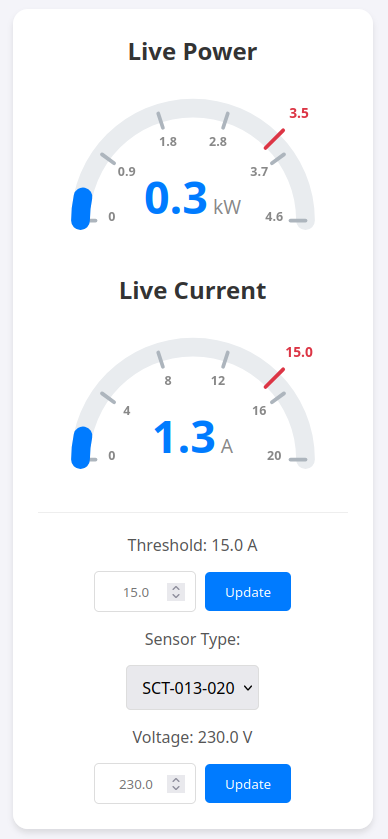
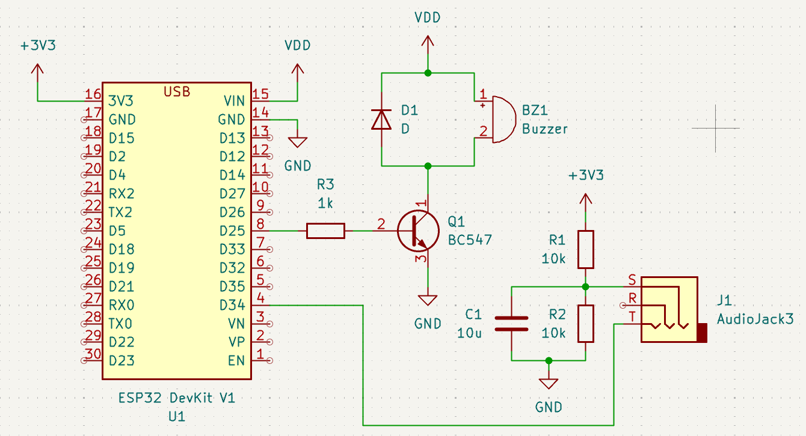

# ESP32 Overcurrent Alarm

A standalone mains current monitoring device based on an ESP32 microcontroller. It was built as a simple weekend project to prevent tripping the main apartment breaker shared by multiple high-powered household appliances. The current is measured using a split-core current transformer (SCT-013).

The web interface lets the user set the upper current limit for the alarm and monitor real-time current draw. Live power consumption is also shown but only as an approximation calculated as `current x voltage`. Voltage is set as a constant value and can be adjusted manually in the web interface (default is 230 V).

### Web interface



## Features

- Live current (A) and estimated power (kW) measurement
- Visual (LED) and audible (buzzer) alarm when current exceeds the set threshold
- Adjustable alarm threshold (default 2 A) and mains voltage (default 230 V) via the web UI
- Selectable SCT-013 sensor rating: 5 A, 10 A, 15 A, 20 A, 25 A, 30 A, 50 A, 60 A, 100 A
- Settings (threshold, sensor, voltage) saved to persistent memory
- Wi-Fi setup via captive portal if the preset network can't be reached
- Watchdog that resets the device if the firmware hangs for more than 5 s

## Hardware

- ESP32 DOIT DevKit V1
- SCT-013 split-core current transformer with built-in burden resistor
- DC bias circuit:
    - 2 x 10 kΩ resistors
    - 10 µF capacitor
- Buzzer with a driver:
    - Electromagnetic (recommended) or piezo buzzer
    - Flyback diode
    - Transistor
    - Current limiting resistor
- 3.5 mm audio jack

| Signal | GPIO |
|:---|---:|
| Current transformer (ADC input) | 34 |
| Buzzer | 25 |
| Alarm LED (built-in) | 2 |

> **Note:** The SCT-013-000 (100 A) is a current-output model without a built-in burden resistor. It needs an external burden resistor to work with this circuit. The firmware already supports it.

### Wiring diagram



## Setup

### Prerequisites
1. PlatformIO is installed (VSCode extension recommended)
2. USB-to-UART bridge drivers are installed

### 1. Create `config.h`

This file is excluded from Git. Create it in the `include/` folder (`include/config.h`):

```cpp
#ifndef CONFIG_H
#define CONFIG_H

constexpr const char* WiFiSsid     = "your-wifi-name";
constexpr const char* WiFiPassword = "your-wifi-password";
constexpr const char* apSsid       = "ESP32-Overcurrent";
constexpr const char* apPassword   = "setup1234";

#endif /* CONFIG_H */
```

On startup the device tries the network in `config.h`. If it can't connect, it starts a password-protected Wi-Fi access point. Connect to it and use the captive portal to configure your network.

### 2. Build and flash

1. Open **PlatformIO**
2. Run **Upload**
3. Run **Upload File System Image**
4. Open **Monitor** (Optional)

### 3. Open the dashboard

Find the ESP32's IP address in your router's device list and navigate to `http://<esp32-ip>/` in a browser on the same network.

> If the device didn't connect due to wrong configuration, it will switch to AP mode. Open Wi-Fi settings on your phone or computer and connect to the ESP32 AP. Then select your network and connect to it.

### 4. Calibrate (optional)

The current reading is scaled by `CALIBRATION_FACTOR` in `src/main.cpp` (default `0.25`). The calibration value passed to EmonLib is `sensor rating x CALIBRATION_FACTOR`. The default `0.25` mainly compensates for EmonLib assuming a 10-bit ADC, while the ESP32 ADC is 12-bit.

To calibrate, measure a known load with a clamp meter (or use a resistive appliance with a known rating) and compare it with the value shown in the web interface. Then scale the factor: `new factor = old factor x (measured current / displayed current)`. Readings below 0.08 A are treated as noise and shown as 0.

## Notes

- When the alarm is on, the built-in LED flashes and the buzzer beeps in sync (500 ms on, 500 ms off)
- By default the firmware drives a passive buzzer with a 2 kHz tone (`#define PASSIVE_BUZZER` in `src/main.cpp`). For an active buzzer (with a built-in oscillator), comment out this line and the pin is switched on and off instead
- The wiring diagram assumes the device is powered via USB or VIN with a 5 V supply
- Standard breakers trip within 1 h at `1.45 x rated current` and within seconds at around `2.5 x rated current`. The alarm is meant to warn about these short, high overloads (e.g. dishwasher, iron and microwave running at once). Set the limit above the breaker rating (e.g. 13–15 A for a B10) to avoid false alarms from short bursts like a coffee machine switching on
- Because the limit is set above the breaker rating, the alarm will not trigger on a long but low overcurrent (e.g. 11–12 A on a B10), which can still trip the breaker after a longer time. A timer that sounds the alarm when the current stays above the rating for too long would cover this case, but it was not needed for the original use case of this device
